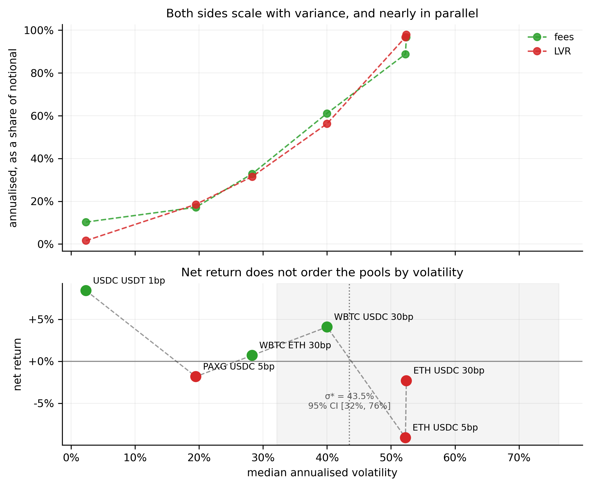
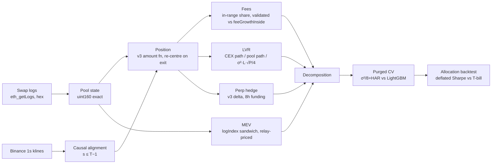
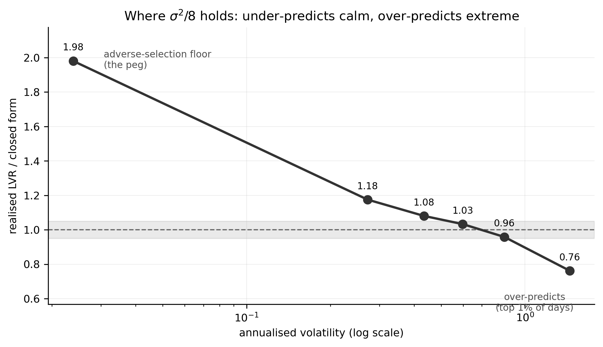

# The True Cost of Providing Liquidity in Uniswap v3

[](https://github.com/YV0007/Decomposing-a-Uniswap-v3-Liquidity-Pools/actions/workflows/tests.yml)

**Reconstructing an LP position per block from raw swap logs, decomposing its return into fees, adverse selection (LVR), MEV, gas and hedge funding, and testing the σ²/8 closed form against what the pool actually lost.**

An AMM liquidity provider is a passive market maker quoting a deterministic curve against whoever arrives first after the reference price moves. Its advertised fee APR is gross of what that costs. This repository follows a **$100k position across 7 pools and 43 months** (11.2M swap events, 2023-01 to 2026-07), aligns every block causally to Binance 1-second prices, and measures `net = fees − LVR − MEV − gas − funding` with a confidence interval on every number.

Two pools pay. USDC/USDT 1 bp earns **+8.4% a year** net; ETH/USDC 5 bp loses **−9.1%**. Fees and LVR both scale with σ² at nearly the same slope, so net return is the small difference of two large terms and **volatility does not rank pools**. The one-parameter closed form explains **62% of daily LVR variance** and beats gradient boosting out of sample (p < 10⁻⁴). No allocation rule clears a deflated-Sharpe bar against the realised T-bill rate. Working paper: [`outputs/paper/LVR_MEV_WorkingPaper.pdf`](outputs/paper/LVR_MEV_WorkingPaper.pdf).



## Run it

Python 3.11 or newer; the verified environment is 3.13. The test suite runs without any data. The full rebuild fetches 11 GB of swap logs and klines from public endpoints with no API key and takes about 2.5 hours.

```bash
git clone https://github.com/YV0007/Decomposing-a-Uniswap-v3-Liquidity-Pools.git
cd Decomposing-a-Uniswap-v3-Liquidity-Pools
python -m venv .venv && source .venv/bin/activate
pip install -e ".[dev]"
pytest -q                                           # 266 tests, including the stage gates
```

```bash
PYTHONPATH=. python3 scripts/verify_pools.py        # token order, decimals, fee, tick spacing read from each contract
PYTHONPATH=. python3 scripts/reproduce.py           # re-run every gate and the number audit on the built outputs
PYTHONPATH=. python3 scripts/reproduce.py --full    # rebuild everything from raw logs
PYTHONPATH=. python3 scripts/make_paper.py          # typeset the paper from outputs/tables/*.csv
```

Every table is a CSV in `outputs/tables/`, every figure is regenerated by script, and `scripts/audit_deck.py` pins each number quoted in the paper to its source table and fails on drift. One seed, one `config.yaml`.

## How it works



1. **Exact price path.** `sqrtPriceX96` is a `uint160`; it is decoded from hex and carried as `Decimal` at 50 digits until the final division. The `tick` on the same event is withheld as an independent cross-check (`P = 1.0001^tick`). Big integers persist as strings. An integer `TickMath` port and the `Decimal` path test against each other.
2. **Causal alignment with bounded staleness.** A 1-second kline for second `s` covers `[s, s+1)`, so matching the kline at block time `T` admits up to one second of lookahead. The baseline uses the latest kline with `s ≤ T − 1`: strictly causal, staleness known and bounded. Asserted by test. Three alignment rules are swept; the pool-minus-CEX gap on ETH/USDC 5 bp has mean |gap| 4.2 bp and p95 8.9 bp, inside the pool's own fee band.
3. **Position and fees.** ±10% band, re-centred on exit, one cohort per month. Token amounts are exact integers from the v3 amount function; the hedge delta is `∂V/∂S` of that function, not 0.5. Fees accrue per swap pro-rata to the position's share of active liquidity, only while in range. The replay is validated against the contract's own `L · ΔfeeGrowthInside / 2¹²⁸` read with four `eth_call`s: 0.18% / 0.52% agreement on the gate month, and the method abstains when a boundary tick's `feeGrowthOutside` epoch resets.
4. **Three LVR measures.** `lvr_from_cex_path` is what the position loses if arbitraged to the CEX price every block, the discrete analogue of the theory. `lvr_from_pool_path` is what it actually lost from the pool price moving, marked at the external price, and goes negative when uninformed flow pushes the pool away from fair value. `analytical_lvr_rate` is `(σ²/2)·S²·|dn/dS|` with the v3 amount function, `σ²L√P/4` in range, `σ²V/8` for a full-range pool. LVR is not impermanent loss and not arbitrageur profit; the gap between the first two measures is the fee-plus-gas wedge that stops arbitrage firing every block.
5. **MEV priced by the builder market.** Sandwiches are matched on `logIndex` order within a block: same searcher address, opposite directions, a third-party victim between, back leg unwinding the front within a swept tolerance, positive profit. Attribution to the LP is worked leg by leg (the LP round-trips and earns three fees; the victim pays), so the reported quantity is sandwich intensity as a flow-quality covariate under three treatments. Validation uses a price the classifier never saw: blocks with a detected sandwich carry **7.0× the builder→proposer payment** (Flashbots relay, 95% CI [5.7, 8.6]) of blocks with a swap and no sandwich.
6. **Hedge and gas, measured not assumed.** Binance ETH perpetual, hourly rebalance (daily and weekly swept), 4 bp taker fee, funding at the published 8-hour rate, hedging error between rebalances reported. Gas is charged at each block's `baseFeePerGas` for entry, exit and every re-centre, never a period average.
7. **Volatility and the theory test.** 5-minute realised variance over a trailing 24 h is the baseline; 1-minute RV, bipower variation and Garman-Klass are raced on the same days (1-minute has the highest R² and the lowest β from microstructure noise; bipower, which strips jumps the diffusion result does not cover, has β closest to 1). Daily empirical LVR regressed on the analytical rate with Newey-West errors gives **β = 0.81 [0.67, 0.95], R² = 0.62** on 2,613 ETH/USDC pool-days, and β = 0.96 on WBTC/ETH.
8. **Closed-form theory.** Optimal range width in log price under driftless Brownian motion: fee rate `F/δ`, LVR rate `σ²/(4δ)`, exit rate `σ²/δ²` from `E[τ] = δ²/σ²`, with tick spacing bounding δ below and fee income saturating when the position dominates active liquidity. Optimal fee tier: the pool-CEX gap is a random walk reflected at `±f`, each reflection transfers `(L√P/4)(g² − f²)`, and the `f = 0` limit recovers `σ²L√P/4` exactly (asserted by test).
9. **Forecasting without leakage.** Weekly panel, every feature known at `t` (`assert_no_lookahead` is a gate). Cross-validation is purged (training rows whose target window overlaps the fold are dropped) and embargoed (7 further days), because overlapping weekly targets otherwise manufacture R². Every specification tried is logged as it runs, so the deflated Sharpe ratio uses a prospective trial count.
10. **Allocation with full costs from run one.** Weekly rebalance on `predicted_fees − predicted_LVR − gas`, switching charged as an exit plus an entry, benchmarked against equal weight, 50/50 rebalanced, hold, and the ex-post best pool. Excess return is against the realised 4-week T-bill, forward-filled from the last business day at or before each week end.



## Results you can regenerate

Annualised, `fees − LVR − gas`, which is delta-hedged by construction because LVR is defined against the continuously rebalanced portfolio. Block-bootstrap 95% CIs over monthly cohorts; 43 cohorts per pool, 16 for PAXG.

| Pool | median σ | fees | LVR | net | 95% CI | months > 0 |
|---|---:|---:|---:|---:|---|---:|
| USDC/USDT 1 bp | 2.3% | +10.3% | −1.6% | **+8.4%** | [+5.0, +11.6] | 83% |
| PAXG/USDC 5 bp | 19.5% | +17.2% | −18.5% | −1.8% | [−6.2, +3.4] | 50% |
| WBTC/ETH 30 bp | 28.3% | +32.8% | −31.5% | +0.7% | [−1.6, +3.4] | 44% |
| WBTC/USDC 30 bp | 40.0% | +61.1% | −56.3% | **+4.1%** | [−0.5, +9.0] | 47% |
| ETH/USDC 5 bp | 52.3% | +88.8% | −96.8% | −9.1% | [−15.6, −3.3] | 26% |
| ETH/USDC 30 bp | 52.4% | +96.7% | −97.9% | −2.3% | [−5.2, +1.3] | 21% |

LVR arm of the forecast, identical purged folds, 352 out-of-sample pool-weeks:

| Model | RMSE | OOS R² | direction |
|---|---:|---:|---:|
| **σ²/8 with HAR-RV variance forecast** | **1,348** | **+0.126** | 74% |
| historical mean | 1,510 | −0.097 | 50% |
| LightGBM | 1,611 | −0.247 | 57% |

Allocation, weekly, all costs, 2023-01 to 2026-07:

| Rule | ann. return | Sharpe | deflated Sharpe |
|---|---:|---:|---:|
| forecast allocation | +1.5% | 0.36 | 0.20 |
| static USDC/USDT | +6.4% | 1.96 | 0.83 |
| static USDC/USDT, excess over realised rf (4.62%) | −0.3% | −0.10 | 0.04 |
| ex-post best pool each week | +17.3% | 3.71 | |

What the tables say, and what they do not. `fees = 0.043 + 3.06σ²` and `LVR = −0.003 + 3.26σ²` across pools, so the net is a difference of near-parallel terms. Cross-pool `corr(σ, net) = −0.57`, but within pools the fixed-effects slope is +0.05 with CI [−0.25, +0.38]: a Simpson's paradox, not a rule. `LVR/σ²` is one declining curve (41.8 at the peg, 5.2 at 19.5% σ, 3.1 to 3.5 above 28%), so an adverse-selection floor the diffusion model omits dominates in calm markets. Replacing each forecast component with its oracle, perfect variance forecasting is worth 0.9 pp and perfect fee forecasting 11.4 pp: the allocation problem is a volume-forecasting problem. Four earlier claims were falsified by later stages; each is recorded with the test that killed it in [`docs/DECISIONS.md`](docs/DECISIONS.md).

The position is simulated, not observed; path-dependence of v3 range management is approximated and stated. Sandwich detection is same-address and undercounts searchers who rotate addresses, which is why it is checked against relay payments rather than trusted. MEV's dollar magnitude is the least robust number in the paper and is reported as such.

[Working paper](outputs/paper/LVR_MEV_WorkingPaper.pdf) · [every modelling decision and what would reverse it](docs/DECISIONS.md) · [research design](docs/LVR_MEV_PROJECT.md) · [published SQL equivalents of each extraction](dune/)

## What is included

- `src/fetch/` raw-log RPC client with multi-provider replay, Binance kline and funding loaders, Deribit DVOL, block base fee, Flashbots relay, Treasury bill series.
- `src/build/` pool state, causal alignment, position, fee accrual and its contract validation, the three LVR measures, sandwich classification and attribution, perp hedge, re-centring, decomposition.
- `src/model/` realised-variance estimators and HAR, no-lookahead feature panel, purged and embargoed K-fold, the forecast horse race with a Diebold-Mariano test.
- `src/strategy/` allocation signal and the costed backtest with its benchmarks. `src/theory/` optimal range width and optimal fee tier.
- `src/utils/` exact-arithmetic primitives, Newey-West OLS, deflated Sharpe, block bootstrap, the prospective specification log.
- `scripts/` one entry point per stage, run in dependency order by `reproduce.py`; `tests/` 266 tests including every gate.

Implementation was carried out with coding agents under the author's direction; the research questions, modelling decisions, stop rules and interpretation are the author's, and each decision is written down with its reasoning before the stage that depends on it.
